

 

**Siatka terminali do pracy z wieloma agentami Claude Code i Codex naraz, na Windowsie i macOS.**

[**Pobierz**](https://github.com/daven-team/unimux/releases/latest) · [Funkcje](#co-potrafi) · [Dokumentacja](#dokumentacja) · [English](README.md)

 

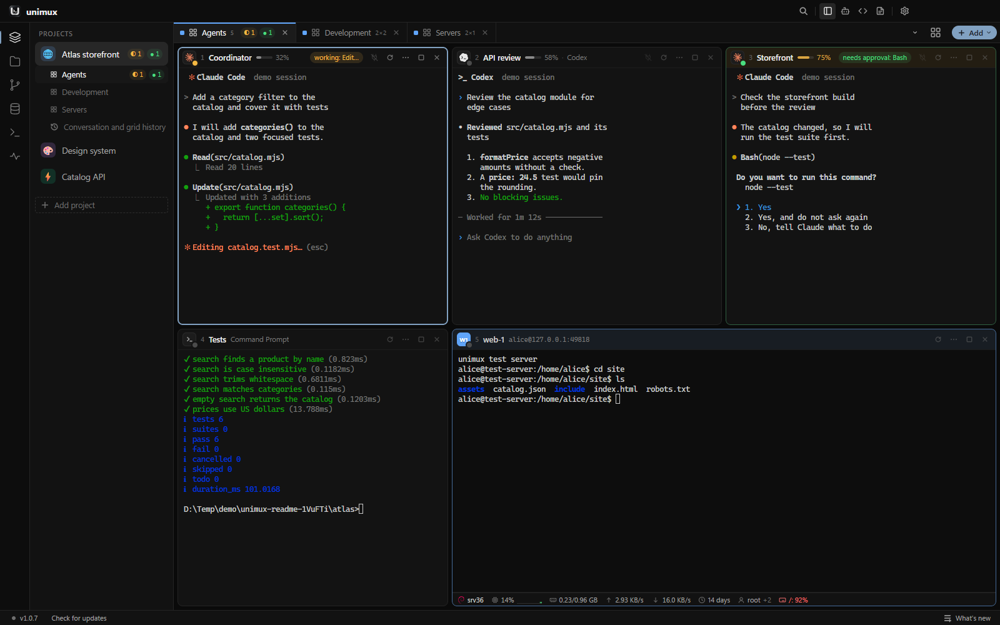

## Po co

Jeden agent AI to nic trudnego. Sześciu agentów w trzech repozytoriach to już kłopot: terminale się mnożą,
nie wiadomo, który czeka na Ciebie, a zamknięcie okna oznacza utratę rozmowy.

unimux daje każdemu projektowi własne siatki terminali, trzyma agentów w tle, pokazuje, który Cię
potrzebuje i dlaczego, i jednym kliknięciem przywraca każdy grid i każdą rozmowę. Wokół agentów ma narzędzia,
po które sięgasz w trakcie ich pracy: pliki, Git, SSH i SFTP, bazy danych, notatki i snippety.

## Co potrafi

- **Agenci w gridzie**: komórki Claude Code, Codex i powłoki jako karty, od jednej do 5×4, ze statusami na żywo, zużyciem kontekstu i alertami
- **Nic nie ginie**: rozmowy wznawiają się po restarcie, zamknięte gridy trafiają do Historii, karty mogą mieć własne okna
- **SSH i SFTP**: zapisane hosty, klucze i tożsamości, komórki SSH z paskiem statusu serwera, dwupanelowy menedżer plików i edycja plików na serwerze
- **Panel Git**: zmiany, commit, graf historii, publikacja na GitHubie i klonowanie
- **Bazy danych**: Postgres, MySQL / MariaDB, SQLite i Redis, także przez tunel SSH
- **Pliki i edytor**: szybkie drzewo plików, karty edytora, szukanie i zamiana, podgląd Markdown, tabele CSV i Parquet
- **Notatki, snippety i paleta `Ctrl+K`** na prompty, listy kontrolne i całą resztę
- **Limity kont AI** dla Claude i Codex oraz **opcjonalny MCP** dla zespołów koordynator / wykonawcy
- **Natywne terminale**: ConPTY na Windowsie (z dyktowaniem przez przytrzymanie spacji), powłoki logowania na macOS, renderowanie na GPU
- Interfejs po polsku, angielsku, niemiecku, hiszpańsku, francusku i portugalsku

### Agenci w gridzie

- **Gridy** od jednej komórki do 5×4, układy rzędami (`3+2`), scalanie komórek i kilka gridów w projekcie. Pasek kart pokazuje gridy i pliki wszystkich projektów (albo tylko aktywnego), a `Ctrl+Tab` przełącza na ostatnio używaną.
- **Komórki jako karty**: każda komórka ma nagłówek z ikoną agenta (iskra Claude, chmurka Codex, znak zachęty powłoki albo host SSH), statusem, nazwą, szczegółami (profil, model, gałąź worktree, user@host) i własnym kolorem.
- **Każda komórka** ma nazwę, kolor, prompt startowy, profil Claude Code / Codex / powłoka, model, rolę MCP i opcjonalny osobny `git worktree`. Przed zamknięciem komórki z worktree aplikacja sprawdza niezacommitowane pliki i niescalone commity.
- **Statusy z powodem**: ◐ pracuje („praca: Edit”), ● czeka na Ciebie, „czeka na zgodę: Bash” od razu, gdy agent pyta o pozwolenie, i czerwony kod wyjścia, gdy polecenie albo CLI zawiedzie. Powiadomienie i dźwięk mówią, który agent skończył albo Cię potrzebuje.
- **Zużycie kontekstu** w nagłówku kart Claude i Codex („32%”) z małym paskiem, bursztynowym powyżej 70% i czerwonym powyżej 90%. Odczyt z plików rozmowy, gdy agent zgłasza zmianę, nigdy przez odpytywanie.
- **Karty we własnym oknie**: przeciągnij grid, plik, tabelę bazy albo kartę Redis poza okno (albo wybierz „Przenieś do nowego okna”), np. na drugi monitor. Terminale pracują dalej, a zamknięcie okna oddaje kartę z powrotem.
- **Plik obok gridu**: „Otwórz obok gridu” pokazuje plik, diff, tabelę albo widok Redis obok gridu, z przesuwanym podziałem.
- **Historia**: zamknięte gridy i dawne rozmowy Claude i Codex (także z usuniętych worktree) wracają jednym kliknięciem, a rozmowy wznawiają się po restarcie.

| Nowy grid | Grid we własnym oknie |
| --- | --- |
| 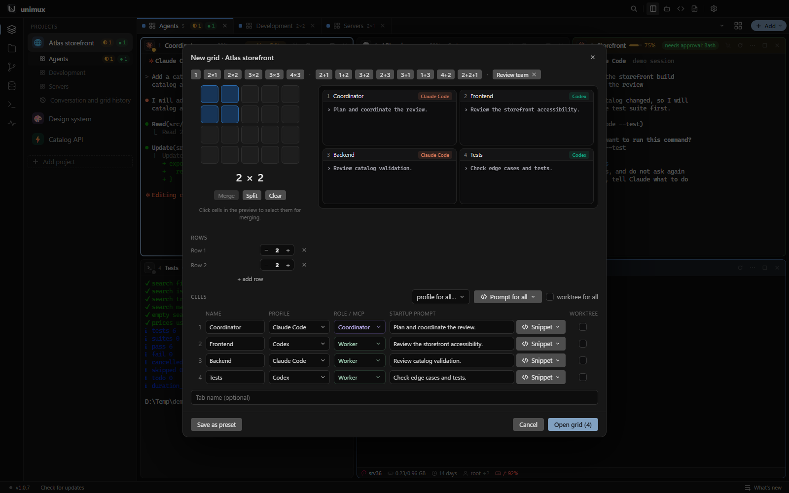 | 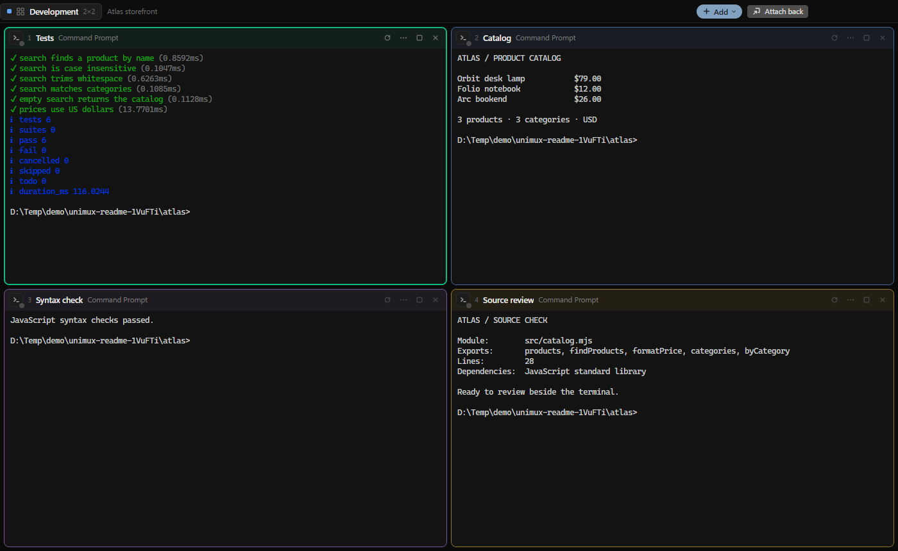 |
| **Plik obok gridu** | **Paleta `Ctrl+K`** |
| 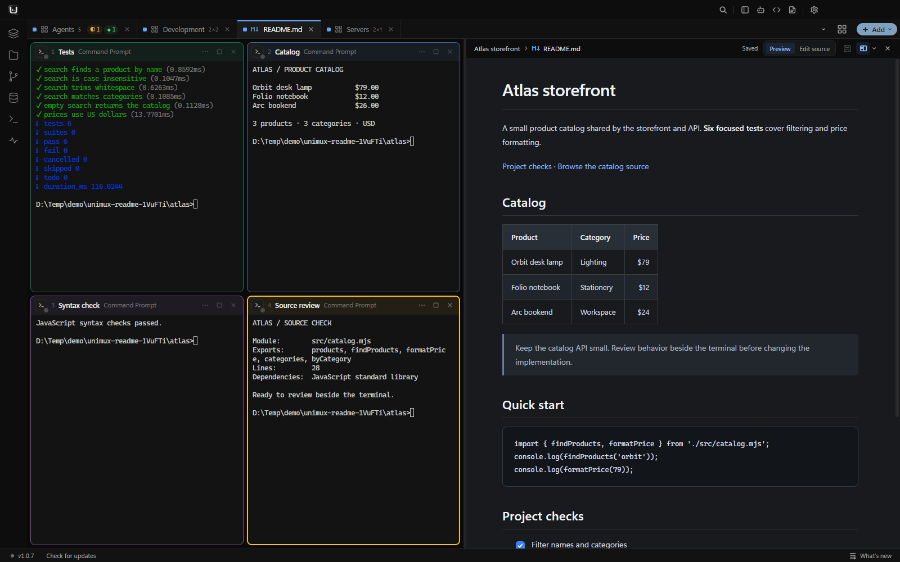 | 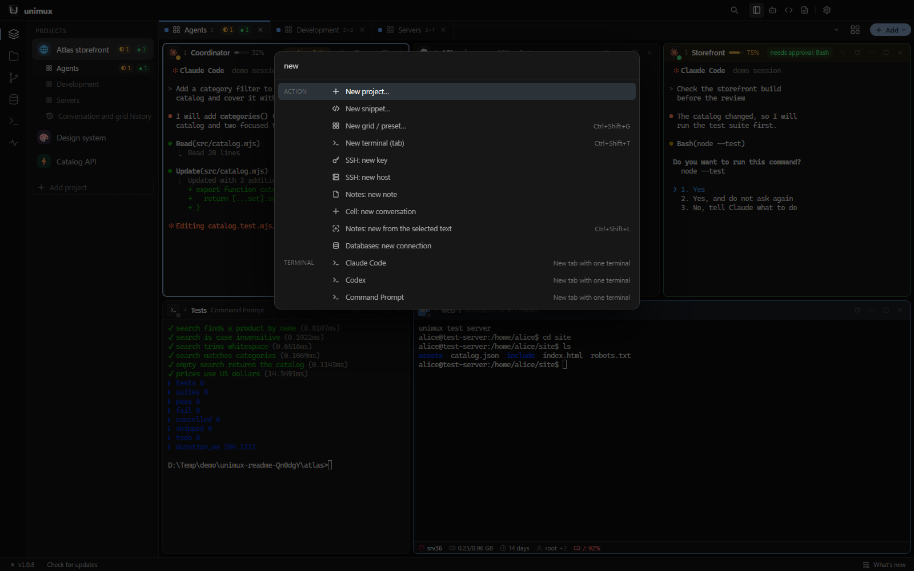 |

### Konta AI i MCP

- **Limity kont AI**: limity 5-godzinne i tygodniowe każdego znanego konta Claude oraz Codex. Na Windowsie możesz zapisać kilka kont Claude i przełączać to, z którego korzysta Claude Code.
- **Opcjonalny MCP** dla zespołów: nadaj komórkom rolę **Koordynator** albo **Wykonawca**, a dostaną lokalne narzędzia do zadań, wiadomości, snippetów i gridów w tle. Koordynator uruchamia cały zespół jednym wywołaniem i czeka na zadania zamiast odpytywać. Agenci mogą zapytać Cię o decyzję (elicytacje MCP, np. przed zamknięciem gridu z otwartymi zadaniami), wskazywać innych agentów po nazwie i czekać jako długie zadanie MCP, jeśli klient to obsługuje. Zobacz [Agenci i lokalny MCP](docs/MCP.md).

### SSH i SFTP

- **Widok SSH** w lewym pasku: zapisane hosty jako kolorowe karty w grupach z tagami, klucze (generowanie Ed25519, ECDSA albo RSA lub import), tożsamości (użytkownik z hasłem i/lub kluczem, wspólne dla wielu hostów) i znane hosty. Klucze i hasła są szyfrowane przez Windows DPAPI albo pęk kluczy macOS i nigdy nie trafiają do agentów.
- **Komórki SSH w każdym gridzie** albo cała grupa otwarta jako grid. Komórka łączy się za **kartą połączenia** z krokami (połączenie, klucz hosta, logowanie, powłoka), pytaniami o klucz hosta i hasło oraz logiem, a gdy coś zawiedzie, ma „Połącz ponownie”.
- **Pasek statusu** pod każdym połączonym terminalem SSH: system i nazwa serwera, CPU z małym wykresem, pamięć, wysyłanie i pobieranie, czas działania, zalogowani użytkownicy i dysk główny (bursztynowy powyżej 80%, czerwony powyżej 90%). Najedź na element, by zobaczyć szczegóły: obciążenie, wszystkie systemy plików, kto jest zalogowany.
- **W terminalu**: podpowiedzi poleceń z historii hosta i Twoich snippetów, dopełnianie **Tab** ścieżek, które naprawdę istnieją na serwerze, siedem motywów kolorów (także osobno dla hosta), **wysyłanie masowe** jednego polecenia do zaznaczonych sesji i opcjonalne wznawianie sesji otwartych przy zamknięciu aplikacji.
- **SFTP**: Twój komputer po lewej, serwer po prawej. Przeciągaj pliki i foldery między stronami (także z pulpitu), przenoś, zmieniaj nazwy, usuwaj, ustawiaj uprawnienia i uruchamiaj SFTP przez sudo. Kolejka transferów pokazuje postęp i pyta: Zastąp, Pomiń albo Zachowaj oba. Kliknij pasek ścieżki (albo `Ctrl+L`), by wpisać ścieżkę z podpowiedziami folderów, a prostokątem zaznaczysz kilka plików naraz.
- **Pliki z serwera w kartach**: otwórz plik z serwera w karcie edytora, a `Ctrl+S` zapisze go z powrotem z zachowaniem uprawnień; plik zmieniony w międzyczasie na serwerze daje wybór: wczytaj ponownie, pokaż różnice albo nadpisz.

| Komórki SSH | SFTP |
| --- | --- |
| 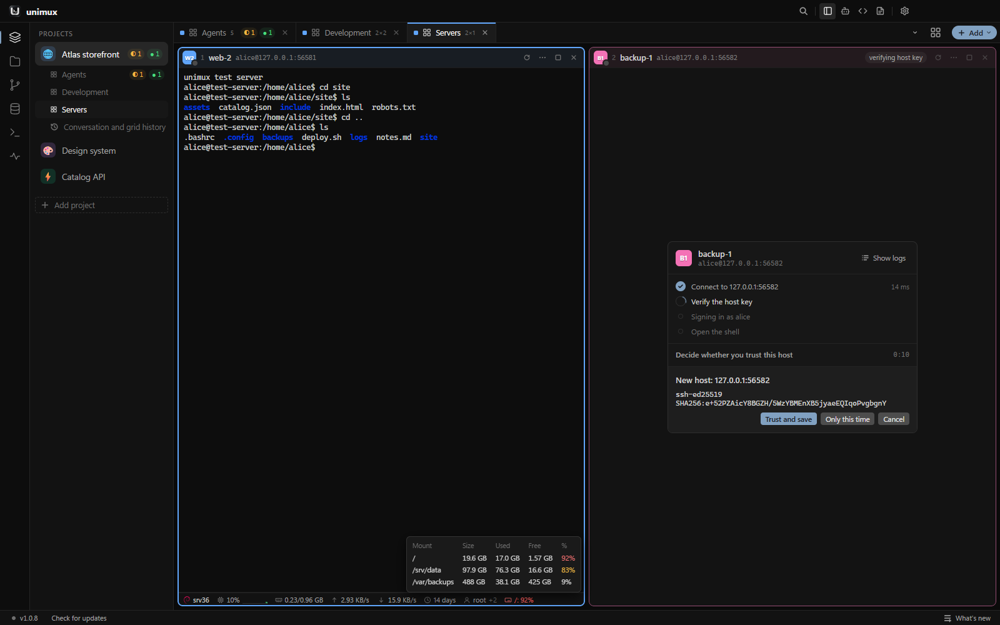 | 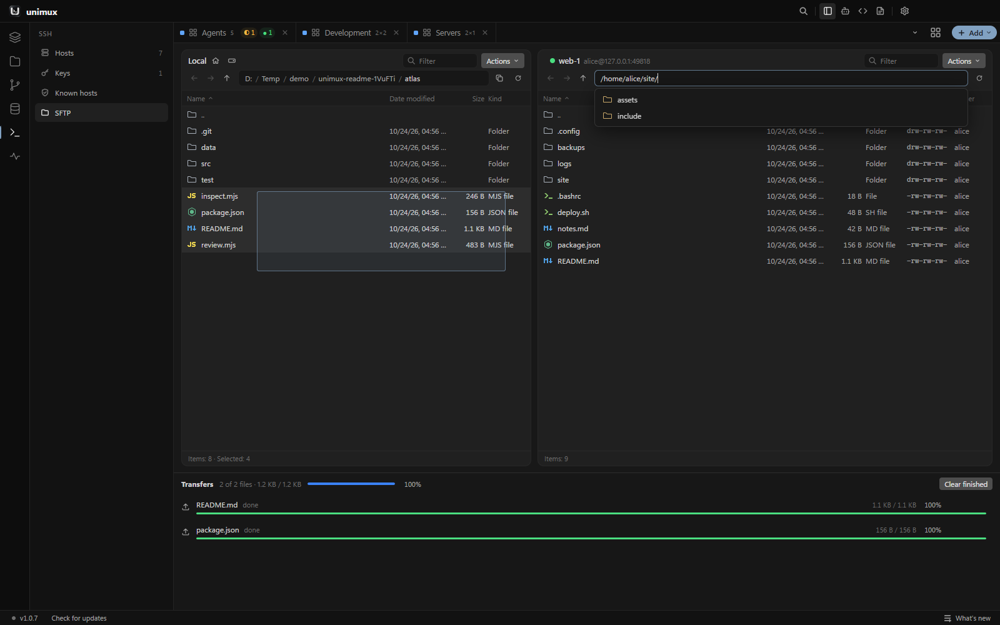 |
| **Widok SSH** | **Ustawienia** |
| 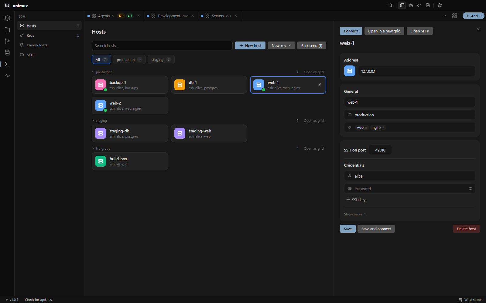 | 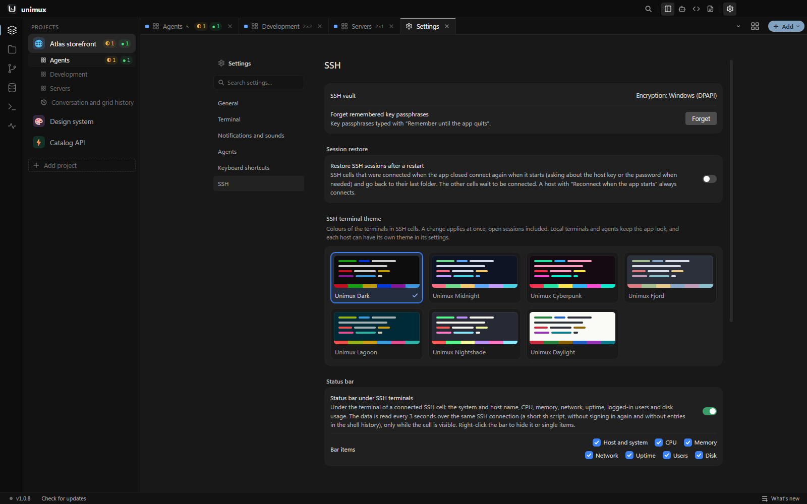 |

### Git

- **Zmiany i commit**: grupy zaindeksowanych, zmienionych i nowych plików, diffy w kartach, pole commita z „Commit i push” oraz fetch, pull i push z licznikami.
- **Historia** jako graf z gałęziami i scaleniami, z wyszukiwaniem, szybka także przy długiej historii.
- **Publikacja na GitHubie** repozytorium bez zdalnego (tworzy repozytorium, dodaje `origin` i wypycha gałąź) oraz **klonowanie** do folderu projektu albo do nowego folderu, który staje się projektem.

| Panel Git | Klonowanie |
| --- | --- |
| 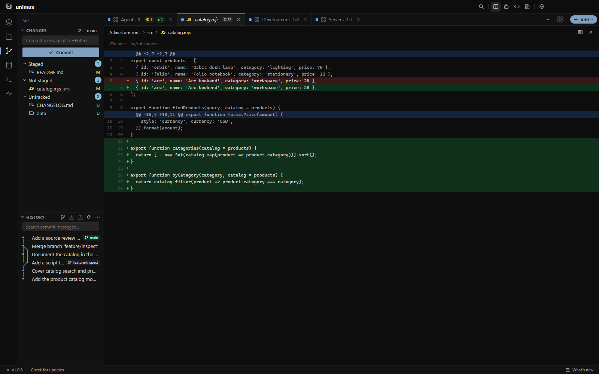 | 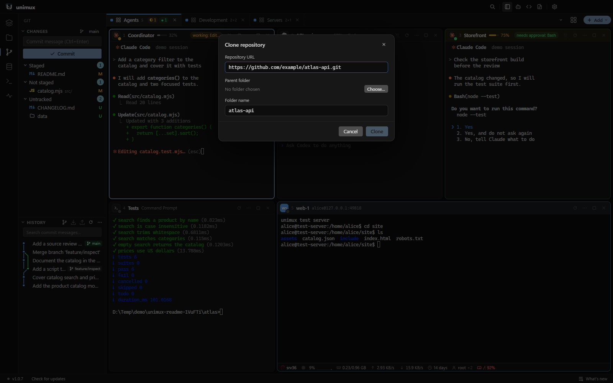 |

### Bazy danych

- **Postgres, MySQL / MariaDB, SQLite i Redis** w panelu baz z folderami i ich kolorami. Połączenie może iść przez jeden z Twoich hostów SSH (bez otwierania portów), używać TLS i być tylko do odczytu. Hasła są szyfrowane jak sekrety SSH; sterowniki są wbudowane i działają w osobnym procesie.
- **Drzewo i tabele**: bazy, schematy, tabele, widoki, procedury, kolumny, klucze, indeksy i DDL. Dane tabeli ze stronicowaniem, sortowaniem, filtrem WHERE i edycją, która czeka podświetlona, aż zapiszesz ją w jednej transakcji (wcześniej możesz zobaczyć SQL).
- **Edytor SQL**: uruchamia polecenie pod kursorem (`Ctrl+Enter`), zaznaczenie albo cały skrypt, pokazuje kilka wyników, anuluje, obsługuje jawne transakcje i eksport, a **historia zapytań** każdego połączenia ma wyszukiwanie i ulubione.
- **Redis**: drzewo kluczy grupowane po `:`, każdy typ wartości z edycją i TTL, konsola, Pub/Sub i informacje o serwerze.

| Dane tabeli | Edytor SQL |
| --- | --- |
| 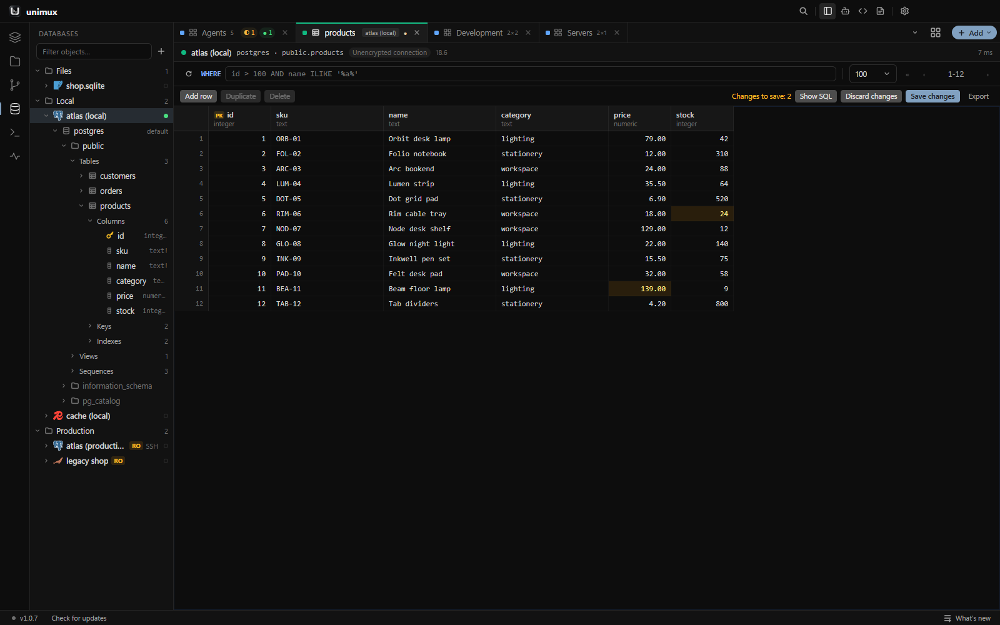 | 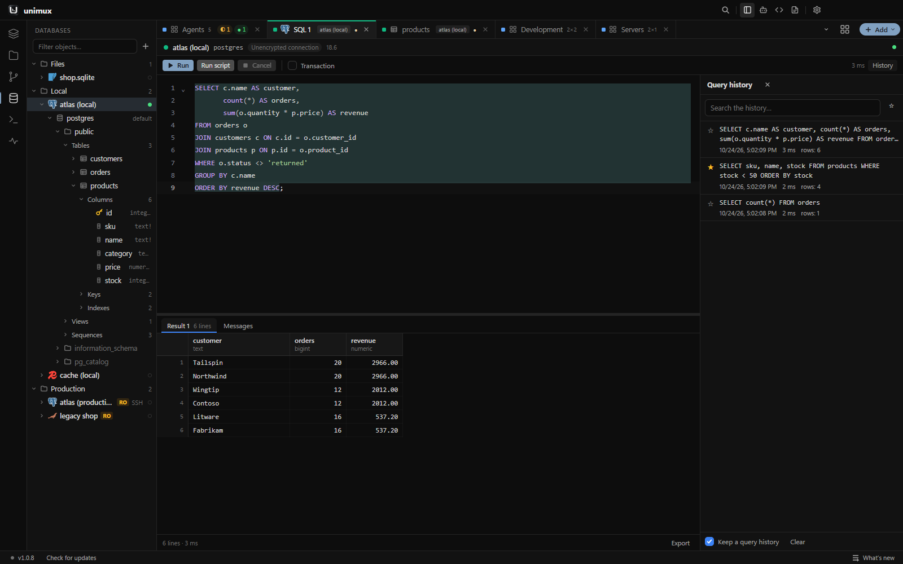 |
| **Redis** | **Połączenie przez SSH i TLS** |
| 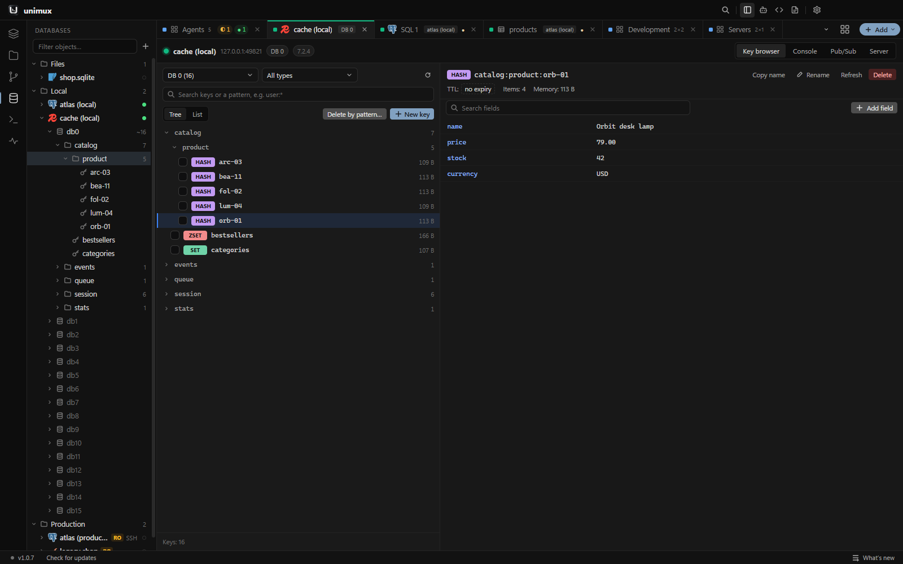 | 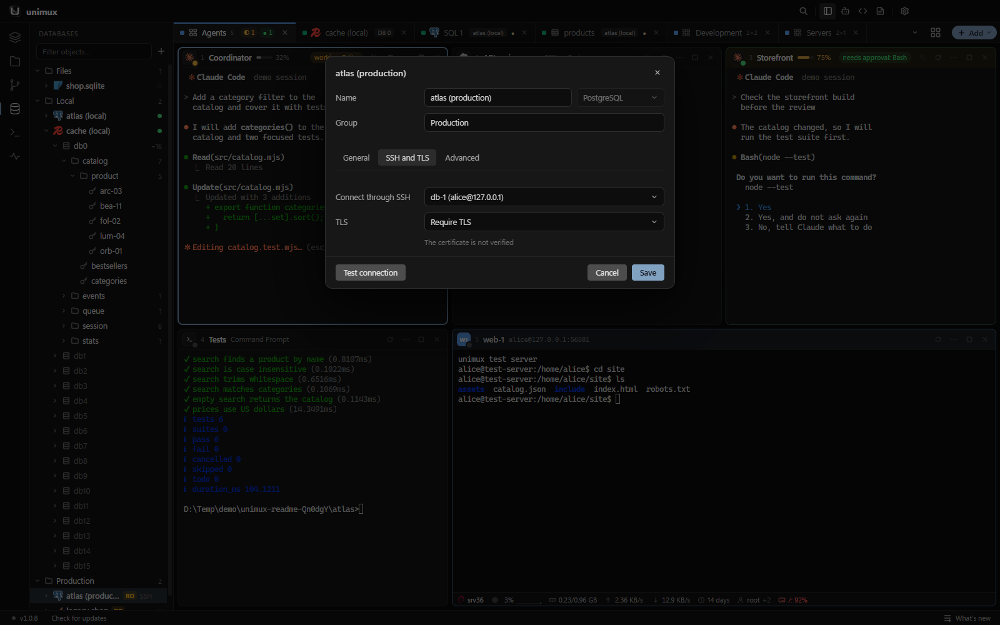 |

### Pliki, notatki i snippety

- **Pliki i edytor**: szybkie drzewo plików ze znacznikami Git, karty podglądu, edytor kodu z podświetlaniem składni, podgląd Markdown, tabele CSV (do 200 000 wierszy) i pliki Parquet. Pliki zmienione przez agenta wczytują się same.
- **Szukanie wszędzie**: `Ctrl+F` w edytorze (`Ctrl+H` dodaje zamianę), w podglądzie Markdown, diffach, tabelach CSV i Parquet oraz dużych plikach, a `Ctrl+Shift+F` w terminalu.
- **Notatki** (`Ctrl+Shift+O`) dla wszystkich projektów albo jednego: Markdown z podświetlanym kodem, podgląd z kopiowalnymi blokami kodu, #tagi z filtrami, listy kontrolne odhaczane w podglądzie, przypięte notatki, szablony, notatka jako pełna karta i szybkie zapisanie zaznaczenia z terminala (`Ctrl+Shift+L`).
- **Snippety** (`Ctrl+Shift+B`): gotowe prompty do jednej komórki albo całego gridu, ze zmiennymi jak `{{focus}}` lub `{{focus:domyślna}}`, o które aplikacja pyta przed wklejeniem, oraz `{{project}}`, `{{path}}`, `{{branch}}`, `{{date}}` i `{{clipboard}}`.
- **Monitor**: CPU i pamięć procesów każdej komórki i samej aplikacji oraz kończenie procesu w komórce.

| Notatki | Zmienne snippetów |
| --- | --- |
| 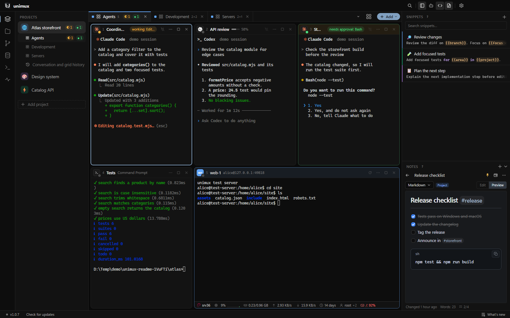 | 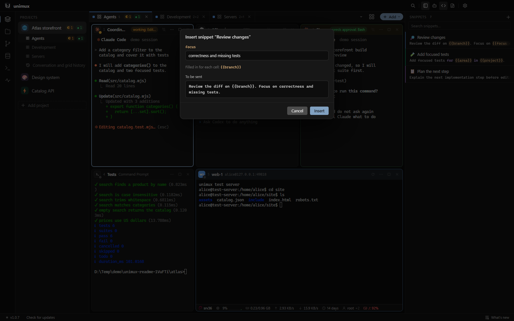 |
| **Edytor z wyszukiwaniem** | **Monitor** |
| 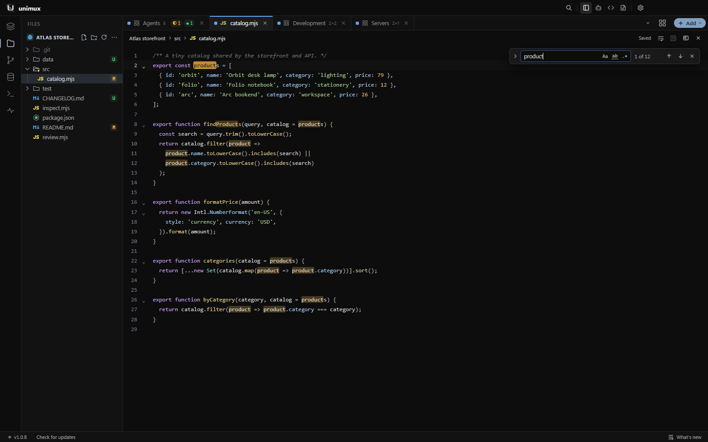 | 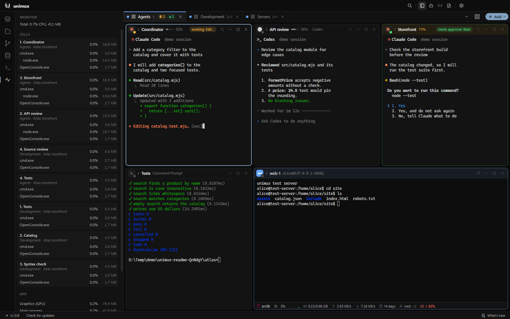 |

## Instalacja

Pobierz najnowszą wersję z [Releases](https://github.com/daven-team/unimux/releases/latest):

| System | Plik |
|---|---|
| Windows 10 1809+ / 11 | `unimux-Setup-x.y.z.exe` |
| macOS, Apple Silicon | `unimux-x.y.z-mac-arm64.dmg` |
| macOS, Intel | `unimux-x.y.z-mac-x64.dmg` |

Wersje na macOS są też dostępne jako archiwa ZIP. Buildy nie są podpisane płatnym certyfikatem. Na Windowsie SmartScreen może wymagać *Więcej informacji → Uruchom mimo to*, na macOS **Ustawienia systemowe → Prywatność i ochrona → Otwórz mimo to**.

Potrzebujesz też agentów w `PATH` powłoki (`claude`, `codex`). Na Windowsie zalecany jest [PowerShell 7](https://aka.ms/powershell); `git` jest potrzebny tylko do worktree i panelu Git.

**Aktualizacje** nigdy nie instalują się bez Twojego kliknięcia: pasek statusu proponuje nową wersję, a **Aktualizacje** w **Ustawienia → Ogólne** pozwalają wybrać tryb **Ręcznie** (domyślny) albo **Automatycznie**, który pyta przy starcie. Szczegóły w [aktualizacjach](docs/UPDATES.md) (po angielsku).

## Szybki start

1. Dodaj projekt (dowolny folder). Agenci pracują w tym folderze.
2. Naciśnij `Ctrl+Shift+G` (`Cmd+Shift+G` na Macu), utwórz grid i wybierz profil dla każdej komórki.
3. Pracuj. Ikony statusu pokazują, który agent na Ciebie czeka i dlaczego; `Ctrl+K` znajdzie wszystko.

## Skróty klawiszowe

Na macOS zamiast `Ctrl` używasz `Cmd`. Każdy skrót można zmienić w **Ustawienia → Skróty klawiszowe**.

| Skrót | Działanie |
|---|---|
| `Ctrl+K` | Paleta poleceń |
| `Ctrl+Shift+G` | Nowy grid albo szablon gridu |
| `Ctrl+Shift+T` | Nowa karta z jednym terminalem |
| `Ctrl+Shift+H` | Historia rozmów i gridów |
| `Ctrl+Shift+M` | Maksymalizuj albo przywróć komórkę |
| `Ctrl+Alt+Strzałki` | Przejście między komórkami |
| `Ctrl+Tab` | Ostatnio używana karta (przytrzymaj `Ctrl`, aby cofnąć się dalej) |
| `Ctrl+Shift+B` / `Ctrl+Shift+O` | Snippety / notatki |
| `Ctrl+Shift+F` | Szukaj w terminalu |
| `Ctrl+Alt+F` | Szukaj we wszystkich rozmowach Claude i Codex |
| `Ctrl+Shift+U` | Jeden prompt do wielu agentów |
| `Ctrl+Shift+D` | Kolejka promptów komórki w fokusie |
| `Ctrl+Alt+PageDown` / `PageUp` | Następna / poprzednia komórka, która czeka na Ciebie |

Pełna lista: [skróty klawiszowe](docs/SHORTCUTS.md) (po angielsku).

## Dokumentacja

- [Agenci i lokalny MCP](docs/MCP.md) (po polsku)
- Po angielsku: [skróty klawiszowe](docs/SHORTCUTS.md), [statusy, alerty i konta AI](docs/ALERTS.md), [panel Git i zaufanie do repozytorium](docs/GIT.md), [połączenia SSH i SFTP](docs/SSH.md), [aktualizacje](docs/UPDATES.md), [development i architektura](docs/DEVELOPMENT.md)

## Licencja

[MIT](LICENSE). Projekt niezwiązany z Anthropic ani OpenAI. Claude Code i Codex są produktami ich właścicieli.
