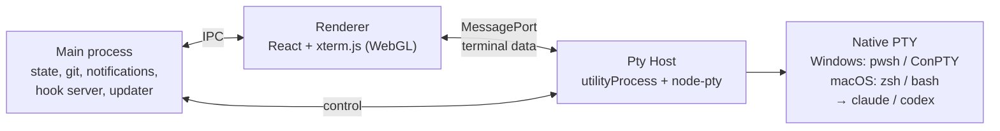

# Development

```powershell
git clone https://github.com/daven-team/unimux
cd unimux
npm install           # .npmrc sets legacy-peer-deps
npm run dev           # app with hot reload
npm test              # unit tests + integration tests against a real native PTY
npm run dist:win      # Windows installer in release/
npm run dist:mac      # macOS DMG + ZIP in release/ (run on a Mac)
npm run test:packaged # verify node-pty using the packaged Electron runtime
npm run test:start    # Windows: start the packaged app like a shortcut does (no console) in a scratch profile
npm run test:ssh-electron # check SSH key types and ciphers under Electron's own Node
```

Built with Electron, TypeScript, React, Zustand, xterm.js, node-pty, electron-vite and Vitest.

| Path | What lives there |
|---|---|
| `src/shared` | Pure logic: layouts, state model, launch commands, status tracking, key encoding |
| `src/ptyhost` | The terminal process (node-pty) |
| `src/main` | Electron main: persistence, sessions index, hooks, worktrees, updater |
| `src/renderer` | The UI |
| `test` | Vitest suites |

## How it works



- **Pty Host.** All terminals live in a separate process and stream straight to the window, so a dozen chatty agents never freeze the UI. Reloading the window keeps every agent alive and replays its output. SSH sessions (ssh2) run there too and use the same output path, flow control and replay, while host keys, keys and passwords stay in the main process, which passes secrets to the Pty Host in memory only. See [SSH connections](SSH.md).
- **Terminal fidelity.** On Windows, node-pty runs with the bundled, newer ConPTY, and unimux implements Windows Terminal's `win32-input-mode`. That delivers real key release events, which is what makes hold Space to talk work. macOS uses native POSIX PTYs with interactive login shells.
- **Status.** Claude Code reports through per-cell hooks passed with `--settings` (your own `settings.json` is never touched). Codex calls a per-process `notify` hook when a turn completes, which also reports the conversation id; its approval prompts arrive as terminal notifications (OSC 9), a usage-limit error is recognized from its output, and an activity heuristic is the fallback. See [Status and alerts](ALERTS.md#how-codex-reports-a-turn).
- **Resume.** Claude cells start with a known `--session-id` and resume with `--resume`. Codex sessions are matched to their cell from `~/.codex/sessions` and resumed with `codex resume`.
- **Background sessions.** Sessions of the active project's other tabs start in the background a moment after launch (one or two at a time, paused while you type or resize). **Settings → Terminal → Load sessions in the background** chooses visible only, the active project (default) or every project. At most 12 sessions (`BACKGROUND_MAX_CELLS`) start this way per launch; the rest start when their tab is opened.
- **Local app state.** Projects, layouts, snippets and MCP inboxes live in `%APPDATA%\unimux\state.json` on Windows and `~/Library/Application Support/unimux/state.json` on macOS. Older versions kept it in an `ajzakomator` folder: on the first start after updating the data is moved to the `unimux` folder and a link is left at the old path, so existing projects, sessions and saved accounts remain available (details in [Branding](BRANDING.md)). Update checks contact GitHub Releases. Agents run their own CLIs and use the services configured for those CLIs.

## Packaging

The renderer-only libraries (xterm, CodeMirror) are bundled by Vite and therefore live in `devDependencies`, so installers only carry what the main process loads at runtime. The Windows build packs the app into `resources/app.asar` (node-pty stays unpacked in `app.asar.unpacked` and is pruned to the win32-x64 binaries), ships only the six supported Chromium locales and leaves the installed app with under 100 files, which makes installing and updating several times faster than with thousands of loose files. The macOS build keeps the plain `resources/app` directory.

## CI

[`.github/workflows/ci.yml`](../.github/workflows/ci.yml) typechecks once (Linux) and runs the unit tests on every platform. Pushes to `main` run the tests on Windows only; `v*` tags, pull requests and manual runs also package Windows x64, macOS ARM64 (`macos-15`) and macOS x64 (`macos-15-intel`) on their native runners, run a packaged smoke test (terminal runtime and every package the main process requires) and upload the installer artifacts. The Electron zip and electron-builder's tools are cached per OS and lockfile; tag runs can only reuse caches made on `main` (a manual run there). macOS builds rebuild native dependencies for Electron. You can trigger Mac builds from Windows with **Actions → CI → Run workflow**.

## Releasing

Windows only: `npm run release` bumps the version, runs the tests, builds and publishes to GitHub Releases (set `NOTES="what changed"` for release notes).

All platforms: add notes in `docs/releases/x.y.z.md`, push a version tag, wait for CI to pass, and run **Actions → Publish release** with the tag and the successful CI run ID. The workflow checks that the build matches the tag, verifies package hashes, combines both Mac update manifests, and publishes all installers in one release.

## Performance

Windows only, after `npm run build`:

- `node scripts/perf-check.mjs [cells] [seconds]` is the regression check (default 20 cmd cells, 15 s windows). It starts the built app with a scratch data dir and home and measures four phases: idle, one "working" dot with no visible output, a 12,000-line flood in every other cell (memory once the scrollback is full) and every cell printing about 60 lines a second. No terminal has the keyboard focus while it measures, so every cell is a background cell. It prints CPU (% of one core) and private memory per process (main, GPU, renderer, Pty Host, SFTP Host), the running animations and the frames the compositor drew. It fails when an animation runs continuously while cells work, when idle costs 1 % of a core or more (the quieter of two windows; a third window is measured before it fails), or when the working dot costs 2.5 % or more or draws 10 frames a second or more. The dot has its own budget because its 1 Hz blink presents two frames a second, each about 0.5 % of a core on a 240 Hz display with 20 WebGL cells. `--json` prints the raw numbers, `--scrollback=N` (one of the setting's choices) starts with that scrollback setting.
- `node scripts/perf-grid.mjs` (frame times and long tasks of a busy grid) and `npm run perf` (`scripts/perf-profile.mjs`, startup profile) give more detail.

Typing latency: `node scripts/perf-latency.mjs` times the drawn echo in the built app (local SSH test server, loopback). `node scripts/ssh-latency-bench.mjs` needs no build and runs on any platform: it times keystroke -> echo through the Pty Host's SSH path (SshManager, OutputChannel, OutputBatcher, a worker thread as the renderer) against a local server behind an emulated round trip of 0 to 300 ms, with echoes of one packet or an echo plus a redraw (zsh, fish), with 16 busy agent terminals in the same host, and (`bursts`) typed like a fast typist: words faster than the server answers, pauses between them. It splits the time into network, host pipeline, input queue and delivery and counts the echoes the host held for more than 2 ms; `--coarse-timers` makes the host's timers fire on 15.6 ms ticks like Windows does when no program asked for a finer timer resolution, and `--src <dir>` measures another checkout's `src` instead (before / after a change; an exported `src` without node_modules works too). In none of the bench's scenarios may a typed echo wait for a coalescing timer (`pipeline > 2 ms` stays at 0, also with `--coarse-timers`). Outside them an echo can still wait for a timer: right after a server got much slower (the echo window is learnt again from the next keys typed after a pause), or in a terminal that prints on its own while you type (its output takes the keystroke's fast flushes).

Keep the status indicators free of infinite CSS animations: one running animation makes Chromium present a frame at every vsync (about 40 % of a core on a 240 Hz display). The working dot and the long-running spinners (refresh arrows, the account swap ring) move with one shared 1 Hz timer instead (`src/shared/blink.ts`), which stops while the window is hidden and under reduced motion. node-pty's ConPTY output Worker gets small heap reservations and an error listener at install time (`scripts/patch-node-pty.cjs`, run by `postinstall` and checked by `npm run test:packaged`); after a node-pty upgrade the patch fails loudly until it is adapted.

## Screenshots

To refresh the README images after building, run `node scripts/capture-readme.mjs`. It launches a separate offscreen Electron instance with temporary data and captures the actual UI via CDP. See the [capture instructions](screenshots/README.md).
