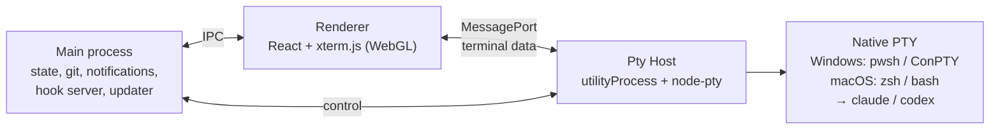

# Development

```powershell
git clone https://github.com/daven-team/unimux
cd unimux
npm install           # .npmrc sets legacy-peer-deps
npm run dev           # the Tauri app with the Vite dev server (hot reload of the UI)
npm test              # vitest: src/shared and the renderer
npm run cargo -- test --workspace --manifest-path src-tauri/Cargo.toml   # the Rust tests
npm run typecheck     # tsc for the renderer, src/shared, scripts' configs and the tests
npm run gen:check     # the generated window.mc contract, message table and golden corpus are up to date
npm run build:check   # optimized exe with the test bridge and dev overrides (src-tauri/target/check) for real-app scripts
npm run build         # release build and installer: NSIS on Windows, app + DMG on macOS (src-tauri/target/release/bundle)
npm run check:bundle  # the bundle carries no node.exe, no .node addon and no JS outside the renderer bundle
node scripts/smoke-start.mjs # Windows: start the check build like a shortcut does (no console) in a scratch profile
npm run test:start    # CI only: install the release setup silently and start the installed exe the same way
```

Built with Tauri 2, Rust, TypeScript, React, Zustand, xterm.js, Vite and Vitest. The shipped app has no Node: the UI is a Vite bundle embedded in the Rust binary.

| Path | What lives there |
|---|---|
| `src/shared` | Pure logic shared by the UI and the scripts: layouts, state model, launch commands, status tracking |
| `src/renderer` | The UI; `src/renderer/src/bridge` is window.mc over Tauri (mcApi.ts + api.d.ts are the contract) |
| `src-tauri` | The Rust workspace: the app (`unimux-app`) and its crates (docs/tauri/ARCHITECTURE.md) |
| `test` | Vitest suites, the golden corpus the Rust tests check against, and PORTING.md |

## How it works



- **Pty Host.** All terminals live in a separate process and stream straight to the window, so a dozen chatty agents never freeze the UI. Reloading the window keeps every agent alive and replays its output. SSH sessions (ssh2) run there too and use the same output path, flow control and replay, while host keys, keys and passwords stay in the main process, which passes secrets to the Pty Host in memory only. See [SSH connections](SSH.md).
- **Terminal fidelity.** On Windows, node-pty runs with the bundled, newer ConPTY, and unimux implements Windows Terminal's `win32-input-mode`. That delivers real key release events, which is what makes hold Space to talk work. macOS uses native POSIX PTYs with interactive login shells.
- **Status.** Claude Code reports through per-cell hooks passed with `--settings` (your own `settings.json` is never touched). Codex calls a per-process `notify` hook when a turn completes, which also reports the conversation id; its approval prompts arrive as terminal notifications (OSC 9), a usage-limit error is recognized from its output, and an activity heuristic is the fallback. See [Status and alerts](ALERTS.md#how-codex-reports-a-turn).
- **Resume.** Claude cells start with a known `--session-id` and resume with `--resume`. Codex sessions are matched to their cell from `~/.codex/sessions` and resumed with `codex resume`.
- **Background sessions.** Sessions of the active project's other tabs start in the background a moment after launch (one or two at a time, paused while you type or resize). **Settings → Terminal → Load sessions in the background** chooses visible only, the active project (default) or every project. At most 12 sessions (`BACKGROUND_MAX_CELLS`) start this way per launch; the rest start when their tab is opened.
- **Local app state.** Projects, layouts, snippets and MCP inboxes live in `%APPDATA%\unimux\state.json` on Windows and `~/Library/Application Support/unimux/state.json` on macOS. Older versions kept it in an `ajzakomator` folder: on the first start after updating the data is moved to the `unimux` folder and a link is left at the old path, so existing projects, sessions and saved accounts remain available (details in [Branding](BRANDING.md)). Update checks contact GitHub Releases. Agents run their own CLIs and use the services configured for those CLIs.

## Packaging

The renderer-only libraries (xterm, CodeMirror) are bundled by Vite and therefore live in `devDependencies`, so installers only carry what the main process loads at runtime. The Windows build packs the app into `resources/app.asar` (node-pty stays unpacked in `app.asar.unpacked` and is pruned to the win32-x64 binaries), ships only the six supported Chromium locales and leaves the installed app with under 100 files, which makes installing and updating several times faster than with thousands of loose files. The macOS build keeps the plain `resources/app` directory.

## CI

[`.github/workflows/ci.yml`](../.github/workflows/ci.yml) typechecks once (Linux) and runs the unit tests on every platform. Pushes to `main` run the tests on Windows only; `v*` tags, pull requests and manual runs also package Windows x64, macOS ARM64 (`macos-15`) and macOS x64 (`macos-15-intel`) on their native runners, run a packaged smoke test (terminal runtime and every package the main process requires) and upload the installer artifacts. The Electron zip and electron-builder's tools are cached per OS and lockfile; tag runs can only reuse caches made on `main` (a manual run there). macOS builds rebuild native dependencies for Electron. You can trigger Mac builds from Windows with **Actions → CI → Run workflow**.

## Releasing

Windows only: `npm run release` bumps the version, runs the tests, builds and publishes to GitHub Releases (set `NOTES="what changed"` for release notes).

All platforms: add notes in `docs/releases/x.y.z.md`, push a version tag, wait for CI to pass, and run **Actions → Publish release** with the tag and the successful CI run ID. The workflow checks that the build matches the tag, verifies package hashes, combines both Mac update manifests, and publishes all installers in one release.

## Performance

Windows only, after `npm run build:check`:

- `node scripts/perf-hidden.mjs` (output and timers of a minimized window) and `node scripts/bench-jank.mjs` (UI smoothness) are the regression checks; R2 compares them with 1.1.4.
- `node scripts/perf-grid.mjs` (frame times and long tasks of a busy grid) and `npm run perf` (`scripts/perf-profile.mjs`, startup profile) give more detail.

Typing latency: `node scripts/perf-latency.mjs` times the drawn echo in the check build (local SSH test server, loopback). (1.1.x also had `scripts/ssh-latency-bench.mjs`, a benchmark of the Node Pty Host's SSH path; it left with Electron in 1.2.0.)

Keep the status indicators free of infinite CSS animations: one running animation makes Chromium present a frame at every vsync (about 40 % of a core on a 240 Hz display; the 1.0.8 dot pulse cost 43 % with 16 cells). A working status mark (`src/renderer/src/components/StatusMark.tsx`, `statusStyles.css`: the badges, the cell icon's corner, the header) turns smoothly for a few finite turns when it appears and then steps with one shared timer (`src/shared/blink.ts`, `src/renderer/src/blink.ts`: `data-pulse` on `<html>`, four phases of 320 ms), which stops while the window is hidden and under reduced motion (a still mark). The spinners (refresh arrows, the account swap ring) turn with CSS only while they are shown. node-pty's ConPTY output Worker gets small heap reservations and an error listener at install time (`scripts/patch-node-pty.cjs`, run by `postinstall` and checked by `npm run test:packaged`); after a node-pty upgrade the patch fails loudly until it is adapted.

## Screenshots

To refresh the README images after building, run `node scripts/capture-readme.mjs`. It launches a separate offscreen Electron instance with temporary data and captures the actual UI via CDP. See the [capture instructions](screenshots/README.md).
